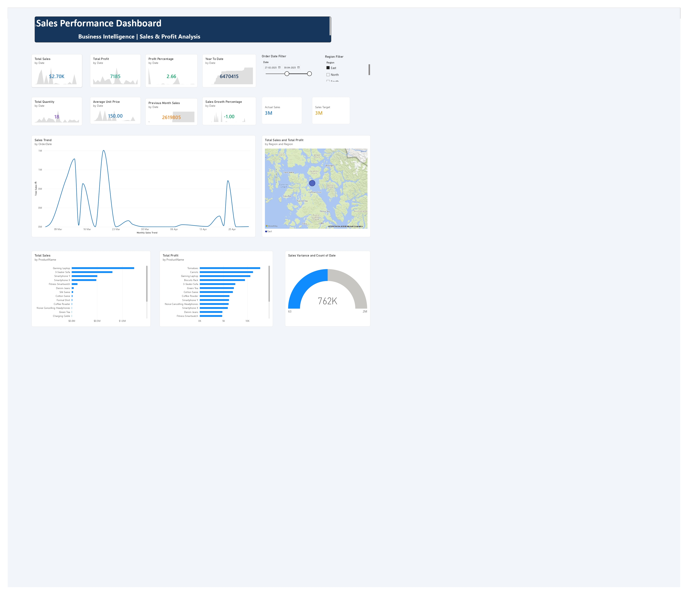

# Syntecxhub Internship Project 1 – Sales Performance Dashboard

[](https://powerbi.microsoft.com/)
[](https://powerbi.microsoft.com/)
[](https://learn.microsoft.com/en-us/dax/)
[](#)

A comprehensive Business Intelligence dashboard developed as part of **Syntecxhub Internship Project 1**. This project focuses on **Sales & Profit Analysis**, transforming multi-table transactional data into actionable executive insights through data modeling, DAX measures, and interactive Power BI visualizations.

---

## 📊 Dashboard Preview



*Figure: Syntecxhub Sales Performance Dashboard – Business Intelligence | Sales & Profit Analysis.*

---

## 🎯 Project Objectives

The primary goal of this project is to provide a complete analytical overview of business sales performance, operational efficiency, and profitability:

1. **Data Cleaning & Transformation**:
   - Ingest raw sales transaction records and validate schema consistency.
   - Cleanse data types, handle missing values, and establish standard date formats.
   - Structure data into dedicated fact and dimension tables (`FactSales`, `DimProduct`, and `DateTable`).

2. **Monthly, Quarterly & Yearly Sales Trends**:
   - Analyze temporal revenue trajectories over order dates using interactive line charts (`Sales Trend`).
   - Track performance momentum using period metrics such as **Year To Date (YTD)**, **Previous Month Sales (PMS)**, and **Sales Growth Percentage**.

3. **Top-Selling & Low-Performing Product Analysis**:
   - Compare product sales volume and gross revenue across all catalog items (`Total Sales by ProductName`).
   - Contrast sales revenue against net profitability (`Total Profit by ProductName`) to identify margin leaders versus volume drivers.
   - Identify low-performing products to support inventory rebalancing and promotional strategies.

4. **Region-Wise & Category-Wise Sales Comparison**:
   - Map regional sales distribution using geospatial visualization (`Total Sales and Total Profit by Region`).
   - Facilitate geographic filtering across North, East, South, and West zones.
   - Analyze product category performance variations across distinct sales territories.

5. **Executive KPI Analysis**:
   - Monitor high-level business health through real-time KPI scorecards with integrated historical trend sparklines.
   - Benchmark operational performance by comparing **Actual Sales** against **Sales Target** alongside a **Sales Variance** radial gauge.

6. **Interactive Power BI Dashboard**:
   - Build a clean, responsive single-page executive report.
   - Provide intuitive slicers (Date range slider and Region checklist) for on-demand drill-down and cross-filtering across all visual cards and charts.

---

## 🛠️ Tools & Technologies Supported by the Project

This project leverages Microsoft's native Business Intelligence stack:

- **Microsoft Power BI Desktop**:
  - Star schema relational data modeling.
  - Interactive multi-visual dashboard canvas and custom card design.
  - Slicers, geospatial mapping, clustered horizontal bar charts, line charts, and radial gauge controls.
  
- **Power Query (M Engine)**:
  - Data ingestion, cleansing, transformation, and type profiling.
  - Extraction and structuring of dimension tables (`DimProduct`, `DateTable`) and central transaction fact table (`FactSales`).

- **DAX (Data Analysis Expressions)**:
  - Formulated calculated business measures in `FactSales` powering all dashboard cards, gauges, charts, and sparklines.

---

## 📐 Data Architecture & Modeling

The project is structured using a **Star Schema** to optimize query performance, maintain data integrity, and enable dynamic multi-dimensional filtering:

```
      ┌───────────────────────┐
      │       DateTable       │
      ├───────────────────────┤
      │ Date                  │
      └───────────┬───────────┘
                  │ 1
                  │ 
                  │ *
┌─────────────┐   ┌───────────────────────┐
│ DimProduct  │   │       FactSales       │
├─────────────┤   ├───────────────────────┤
│ ProductName │   │ OrderDate             │
└──────┬──────┘   │ Region                │
       │ 1        │ ProductName           │
       │          │ (DAX Business Logic)  │
       │ *        └───────────────────────┘
       └──────────┘
```

### Tables Overview
- **`FactSales`**: Central transactional table storing core sales transactions, order dates, regions, sales quantities, unit prices, and all associated DAX calculated measures.
- **`DimProduct`**: Dimension table holding product descriptive attributes (`ProductName`) linked to `FactSales`.
- **`DateTable`**: Dedicated calendar dimension table facilitating robust time-intelligence calculations, date slicing, and sparkline trendlines.

---

## 🧮 DAX Measures Implemented

All analytical calculations in this dashboard are computed using DAX measures modeled inside `FactSales`:

| Measure Name | Analytical Purpose | Supported Visual(s) |
| :--- | :--- | :--- |
| **`Total Sales`** | Aggregate gross sales revenue generated across transactions. | KPI Card, Horizontal Bar Chart, Map Visual (Bubble Size) |
| **`Total Profit`** | Aggregate profit generated across sales transactions. | KPI Card, Horizontal Bar Chart, Map Visual (Tooltip) |
| **`Profit Percentage`** | Ratio of net profit to total revenue evaluating business efficiency. | KPI Card (with trend sparkline) |
| **`Year To Date`** | Cumulative sales revenue accumulated from the start of the year. | KPI Card (with trend sparkline) |
| **`Total Quantity`** | Total units sold across all completed orders. | KPI Card (with trend sparkline) |
| **`Average Unit Price`** | Average unit price per item sold. | KPI Card (with trend sparkline) |
| **`Previous Month Sales`** | Prior period sales benchmark for Month-over-Month comparison. | KPI Card (with trend sparkline) |
| **`Sales Growth Percentage`**| Percentage increase or decrease in sales compared to prior period. | KPI Card (with trend sparkline) |
| **`Actual Sales`** | Actual revenue achieved in the monitored period. | Executive Card Visual |
| **`Sales Target`** | Predefined business target for sales revenue comparison. | Executive Card Visual |
| **`Sales Variance`** | Variance tracking gap between actual performance and targets. | Radial Gauge Visual |
| **`Sales Trend`** | Dynamic sales measure plotted against calendar order dates. | Monthly Sales Trend Line Chart |

---

## 📈 Dashboard Layout & Visual Components

The dashboard is structured into logical executive zones for rapid decision-making:

1. **Header Banner**:
   - Title: `Sales Performance Dashboard`
   - Subtitle: `Business Intelligence | Sales & Profit Analysis`

2. **Executive KPI Scorecards (with Historical Trend Sparklines)**:
   - Primary Metrics: `Total Sales`, `Total Profit`, `Profit Percentage`, `Year To Date`
   - Operational Metrics: `Total Quantity`, `Average Unit Price`, `Previous Month Sales`, `Sales Growth Percentage`

3. **Target & Variance Benchmarking**:
   - `Actual Sales` & `Sales Target` Callout Cards
   - `Sales Variance and Count of Date` Radial Gauge Visual

4. **Interactive Slicers & Filtering Pane**:
   - **Order Date Filter**: Range slider allowing custom date filtering (`DateTable.Date`).
   - **Region Filter**: Multi-option checkbox selection (`FactSales.Region`).

5. **Geographical & Trend Visualizations**:
   - **Monthly Sales Trend Line Chart**: Plots `Sales Trend` across `OrderDate` to reveal seasonality and sales spikes.
   - **Geographic Bubble Map**: Displays regional performance (`Region`), sizing bubbles by `Total Sales` and surfacing `Total Profit` on hover.

6. **Product Performance & Profitability Breakdown**:
   - **Total Sales by ProductName**: Horizontal bar chart identifying high-volume and high-revenue products (e.g., Gaming Laptop, 3-Seater Sofa, Smartphones) down to lower-volume accessories.
   - **Total Profit by ProductName**: Horizontal bar chart ranking products by net profitability (e.g., Tomatoes, Carrots, Gaming Laptop, Biscuits Pack, 3-Seater Sofa).

---

## 📁 Repository Structure

```
Syntecxhub_Sales_Performance_Dashboard/
│
├── .gitignore                                      # Standard Git ignore rules for Power BI & OS files
├── README.md                                       # Comprehensive project documentation
├── Sales Performance Dashboard.pbix                # Original Power BI project file (Data model & report)
├── Sales_Performance_Dashboard.pdf                 # Exported static dashboard report (PDF)
│
└── Images/
    └── Sales_Performance_Dashboard_page-0001.jpg   # High-resolution dashboard screenshot
```

---

## 🚀 How to Open and View the Project

### Option 1: Microsoft Power BI Desktop (Interactive)
1. Clone or download this repository:
   ```bash
   git clone https://github.com/Marimuthu-2004/Sales-Performance-Dashboard.git
   ```
2. Ensure you have [Microsoft Power BI Desktop](https://powerbi.microsoft.com/desktop/) installed.
3. Open `Sales Performance Dashboard.pbix` to interact with all slicers, filters, and dynamic visuals.

### Option 2: PDF or Image Viewer (Static Presentation)
- View the full-page exported report via `Sales_Performance_Dashboard.pdf`.
- View the high-resolution dashboard capture in `Images/Sales_Performance_Dashboard_page-0001.jpg`.

---

## 👤 Author & Acknowledgments

- **Developer**: Mari Muthu M
- **Internship**: Syntecxhub Internship Program
- **Project**: Project 1 – Sales Performance Dashboard
